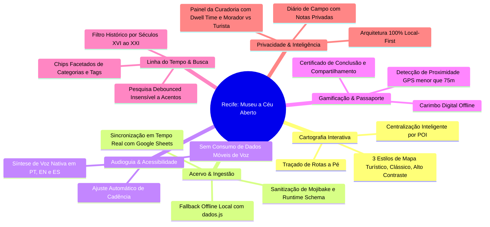
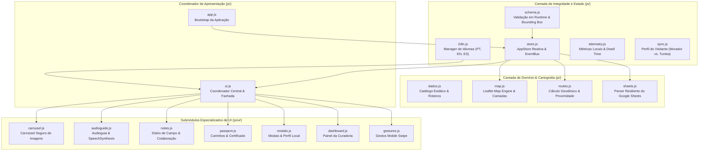

# Recife: Museu a Céu Aberto (MCA)
### *Cartografia Histórica Digital, Gamificação Cultural e Inteligência do Patrimônio Urbano*

[-emerald?style=for-the-badge&logo=checkmarx)](tests/run_tests.ps1)
[-rose?style=for-the-badge&logo=pwa)](sw.js)
[-sky?style=for-the-badge&logo=javascript)](js/)
[](AVISO_DE_PRIVACIDADE.md)
[](vendor/leaflet/)

---

## 🏛️ 1. Sobre o Projeto

O **Recife: Museu a Céu Aberto** é uma plataforma cívico-cultural e educativa concebida pelo historiador e pesquisador **Tales Pedrosa**. O projeto nasce da intersecção entre a **pesquisa em história urbana** e o uso de **geotecnologias abertas**, transformando as ruas, pontes, praças, igrejas e monumentos do Recife em um museu vivo e interativo.

A plataforma cataloga pontos de interesse histórico (POIs) e propõe roteiros temáticos fruto de rigorosa pesquisa curatorial, permitindo que cidadãos, turistas, estudantes e pesquisadores vivenciem a evolução espacial e simbólica da capital pernambucana desde o Século XVI até os dias atuais.

### Problemas que a aplicação resolve:
- **Democratização do Acesso ao Patrimônio:** Disponibiliza acervo documental, iconográfico e histórico de forma gratuita, direta no navegador e sem necessidade de download em lojas fechadas de aplicativos.
- **Turismo Cultural Autônomo e Sustentável:** Proporciona itinerários a pé no Recife Antigo e bairros centrais com geolocalização e audioguia nativo.
- **Engajamento e Gamificação Cívica:** Estimula o sentimento de pertencimento urbano através do **Passaporte Cultural**, com check-ins georreferenciados e diplomas solenes de conclusão de roteiros.
- **Apoio Pedagógico e Políticas Públicas:** Fornece um painel analítico curatorial com métricas de visitação e tempo de permanência (*Dwell Time*) para balizar ações de preservação patrimonial.

---

## ✨ 2. Principais Funcionalidades



### 🗺️ Cartografia Digital Multi-camadas (Leaflet.js)
- Três camadas cartográficas alternáveis: **Turística / Voyager** (estilo urbano limpo da CartoDB/Esri), **Clássica** (OpenStreetMap oficial) e **Alto Contraste** (Dark mode com foco em acessibilidade e economia de bateria em telas OLED).
- Traçado de rotas a pé com Leaflet Routing Machine fixo e seguro.

### 📊 Ingestão Resiliente via Google Sheets
- Conecta-se diretamente à planilha oficial da curadoria via API Google Visualization (GViz) ou CSV.
- **Parser Resiliente:** Normaliza coordenadas brasileiras com separadores de milhar, valida latitudes e longitudes na **Bounding Box Metropolitana do Recife** (-8.50 a -7.80 Lat, -35.20 a -34.70 Lng) e corrige Mojibake (caracteres acentuados corrompidos).

### 🎧 Audioguia Multilíngue Nativo (*SpeechSynthesis*)
- Utiliza a API nativa de voz do sistema operacional (`window.speechSynthesis`), operando **100% offline** e sem custos de consumo de dados ou chamadas de API externas.
- Suporte fluido a **Português (`pt-BR`)**, **Inglês (`en-US`)** e **Espanhol (`es-ES`)**.

### 🏆 Passaporte Cultural & Gamificação Histórica
- **Detecção de Proximidade Geodésica:** Quando o visitante aproxima-se a menos de **75 metros** de um monumento (calculado em tempo real via fórmula de Haversine), a interface ativa o badge verde *"📍 Você está neste local histórico!"*.
- **Carimbo Digital Offline:** Permite carimbar a visita no celular com salvamento seguro no `localStorage`.
- **Roteiros Temáticos:** *Origens do Recife*, *Recife Sagrado* e *Circuito da Poesia*.
- **Certificado de Conclusão:** Ao completar 100% dos locais de um roteiro, o visitante recebe um certificado solene de conclusão com autenticação e botão de compartilhamento para redes sociais e WhatsApp.

### ⏳ Linha do Tempo Urbana (Filtro por Séculos)
- Classificação histórica automática que agrupa monumentos do **Século XVI ao Século XXI**, permitindo aos usuários filtrar o Recife Holandês, o período Colonial, a modernização do Século XIX ou obras contemporâneas.

### 📝 Diário de Campo & Curadoria Colaborativa
- **Notas Pessoais:** O visitante pode registrar anotações privadas, memórias e reflexões sobre cada monumento no seu aparelho.
- **Colaboração Cidadã:** Modal estruturado para submissão direta de relatos, fotografias e correções para a equipe de pesquisa via e-mail curatorial.

### 📈 Painel de Inteligência da Curadoria
- Estatísticas de navegação com métricas de interesse: ranking de POIs mais acessados, maiores tempos médios de permanência (*Dwell Time*) e segmentação analítica cruzada entre **Moradores da Cidade** e **Turistas**.

### 📱 Progressive Web App (PWA) Offline-First
- Service Worker otimizado com precache de assets estruturais (`sw.js`), manifest declarativo, ícones em alta resolução e suporte a instalação como app nativo em Android, iOS e Desktop.

---

## 🏗️ 3. Arquitetura de Software (*Untangled Architecture*)

O projeto foi refatorado seguindo rigorosamente a metodologia **untangle-codebase**, eliminando arquivos monolíticos e estabelecendo uma separação estrita de responsabilidades (*Separation of Concerns*):



### Estrutura de Diretórios
```text
App_Recife_MCA/
├── css/
│   ├── style.css                 # Estilos customizados e animações
│   ├── tailwind.css              # Fonte Tailwind com diretivas @tailwind
│   └── tailwind.generated.css    # CSS compilado e minificado para produção
├── imagens/                      # Ícones PWA e fotos locais de alta resolução
├── js/
│   ├── ui/                       # Submódulos desacoplados de interface (untangle-codebase)
│   │   ├── audioguide.js         # Síntese de voz, vozes e reprodução
│   │   ├── carousel.js           # Carrossel, múltiplos slides e sanitização de imagens
│   │   ├── dashboard.js          # Gráficos, rankings e filtros da curadoria
│   │   ├── gestures.js           # Gestos touch swipe-down no painel móvel
│   │   ├── modals.js             # Gerenciamento de modais (Sobre, Auth, Onboarding)
│   │   ├── notes.js              # Diário de campo e colaboração voluntária
│   │   └── passport.js           # Carimbos, progresso e emissão do certificado
│   ├── app.js                    # Inicialização e orquestração da aplicação
│   ├── dados.js                  # Acervo estático de fallback e rotas históricas
│   ├── i18n.js                   # Sistema de internacionalização (PT/EN/ES)
│   ├── map.js                    # Motor cartográfico Leaflet e marcadores
│   ├── routes.js                 # GPS, cálculo de Haversine e rotas a pé
│   ├── schema.js                 # Validador de schema em runtime e Bounding Box
│   ├── sheets.js                 # Ingestão e parsing resiliente do Google Sheets
│   ├── store.js                  # Padrão Observer / EventBus reativo
│   ├── sync.js                   # Gerenciador de perfil local (Morador vs. Turista)
│   ├── telemetry.js              # Registro anônimo de visualizações e dwell time
│   └── ui.js                     # Fachada e coordenador central de UI
├── tests/
│   ├── index.html                # Interface visual do test runner no navegador
│   ├── integration_tests.js      # Suíte de testes de integração
│   ├── run_tests.ps1             # Runner automatizado em PowerShell (20/20 aprovados)
│   ├── test_runner.js            # Engine customizada de asserções
│   └── unit_tests.js             # Suíte de testes unitários (Haversine, Schema, Sanitização)
├── vendor/
│   └── leaflet/                  # Biblioteca Leaflet fixada localmente
├── .env.example                  # Template documentado de variáveis de ambiente
├── AVISO_DE_PRIVACIDADE.md       # Política de privacidade estrita em conformidade com LGPD
├── index.html                    # Ponto de entrada HTML semântico com CSP e SRI
├── manifest.json                 # Manifesto PWA declarativo
├── package.json                  # Dependências e scripts de build
├── PRIVACY.md                    # Espelho do aviso de privacidade (padrão GitHub)
├── SECURITY-REVIEW.md            # Relatório técnico de auditoria de segurança
├── server.js                     # Servidor Node.js seguro com proteção de rotas
└── sw.js                         # Service Worker PWA (versão museu-recife-v16)
```

---

## 🔒 4. Segurança da Aplicação (AppSec)

A aplicação foi auditada e endurecida contra as principais vulnerabilidades comuns na web:

1. **Content Security Policy (CSP) Estrito:** Meta tag CSP no `<head>` de `index.html` que restringe conexões de rede exclusivamente a provedores oficiais (OpenStreetMap, CartoDB, Google Fonts e Google Sheets/Drive).
2. **Defesa em Profundidade contra DOM-based XSS (CWE-79):**
   - Substituição de interpolação em `innerHTML` por criação semântica de nós (`document.createElement`, `textContent` e `addEventListener`).
   - Sanitização de URLs de imagens com regex restritivo que bloqueia quebra de atributos CSS (`url(...)`), aspas e caracteres de controle.
3. **Servidor Seguro contra Path Traversal (`server.js`):**
   - Validação canônica com `path.resolve()` e `path.relative()` assegurando que requisições nunca acessem diretórios externos ao projeto.
   - Headers de segurança: `X-Content-Type-Options: nosniff`, `Referrer-Policy: same-origin`, `X-Frame-Options: DENY`.
4. **Proteção da Área da Curadoria:**
   - Rotas de métricas `/api/curadoria` e `/curadoria` protegidas via token de autenticação `DEVELOPER_ACCESS_TOKEN` ou cookie `HttpOnly; SameSite=Strict`.

---

## 🛡️ 5. Privacidade e Proteção de Dados (LGPD & GDPR)

O projeto adota a premissa de **Privacy by Design e Local-First**:
- **Zero Rastreamento de Terceiros:** Não há Google Analytics, pixels do Facebook ou redes de anúncios.
- **Armazenamento 100% no Aparelho:** Notas, perfil declarativo, progresso no passaporte e telemetria residem exclusivamente no `localStorage` do seu navegador.
- **Geolocalização Efêmera:** Coordenadas GPS são processadas apenas na memória volátil (RAM) para o cálculo de proximidade e nunca são transmitidas a servidores.
- **Direito à Eliminação:** Botão nativo no app ("Limpar Dados Locais") que apaga imediatamente todos os dados armazenados no navegador.

Consulte o documento completo em [**`AVISO_DE_PRIVACIDADE.md`**](AVISO_DE_PRIVACIDADE.md).

---

## 🚀 6. Instalação e Execução Local

### Pré-requisitos
- [Node.js](https://nodejs.org/) versão 18.x ou superior.
- [npm](https://www.npmjs.com/) (incluso no Node.js).

### Passo a Passo

1. **Clonar o Repositório:**
   ```bash
   git clone https://github.com/usuario/recife-museu-a-ceu-aberto.git
   cd recife-museu-a-ceu-aberto
   ```

2. **Instalar Dependências:**
   ```bash
   npm install
   ```

3. **Configurar Variáveis de Ambiente:**
   ```bash
   cp .env.example .env
   ```

4. **Compilar os Estilos (Tailwind CSS):**
   ```bash
   # Compilação única minificada para produção:
   npm run build:css

   # Ou modo observador para desenvolvimento contínuo:
   npm run watch:css
   ```

5. **Iniciar o Servidor Local Seguro:**
   ```bash
   npm run serve
   ```
   Acesse a aplicação em seu navegador no endereço: **`http://127.0.0.1:4173/`**

---

## 🧪 7. Suíte de Testes Automatizados

O projeto possui cobertura completa de testes automatizados com asserções para regras puras, validação de integridade, cálculo geodésico e comportamento de interface:

### 1. Execução via Linha de Comando (PowerShell):
```powershell
powershell -ExecutionPolicy Bypass -File tests/run_tests.ps1
```
*Resultado: **20 de 20 testes aprovados** (Integridade de Schema, i18n, Gamificação, Curadoria, Telemetria e Precache PWA).*

### 2. Execução no Navegador:
Abra o arquivo [`tests/index.html`](tests/index.html) em qualquer navegador web para visualizar o painel gráfico interativo de execução dos testes com tempo em milissegundos e log detalhado.

### 3. Execução via Node.js:
```bash
node -e "
const fs = require('fs'); const vm = require('vm');
const ctx = { console, Date, Math, String, Number, Array, Object, Set, Map, WeakMap, RegExp, JSON, encodeURIComponent, performance: { now: () => Date.now() }, setTimeout: (fn, ms) => setTimeout(fn, ms), clearTimeout: (id) => clearTimeout(id), addEventListener: () => {}, removeEventListener: () => {} };
ctx.window = ctx; ctx.global = ctx; ctx.document = { createElement: () => ({ tagName: 'div', innerText: '', value: '', style: {}, classList: { classes: new Set(), add(c){this.classes.add(c)}, remove(c){this.classes.delete(c)}, toggle(){}, contains(c){return this.classes.has(c)} }, setAttribute(){}, getAttribute(){}, appendChild(){}, addEventListener(){}, removeEventListener(){}, remove(){}, querySelectorAll:()=>[], querySelector:()=>null }), getElementById: () => null, querySelectorAll: () => [], querySelector: () => null, body: { append: () => {} } };
ctx.localStorage = { _d: {}, getItem(k){return this._d[k]||null}, setItem(k,v){this._d[k]=String(v)}, removeItem(k){delete this._d[k]}, clear(){this._d={}} };
ctx.L = { LatLng: function(a,b){this.lat=a;this.lng=b}, tileLayer:()=>({addTo:()=>{}}), map:()=>({setView:()=>{},addLayer:()=>{},panTo:()=>{}}), marker:()=>({addTo:()=>({bindPopup:()=>{}}),on:()=>{}}), icon:()=>({}), divIcon:()=>({}), layerGroup:()=>({clearLayers:()=>{},addLayer:()=>{},addTo:()=>{}}), Routing:{control:()=>({addTo:()=>{}})} };
vm.createContext(ctx);
['tests/test_runner.js','js/schema.js','js/telemetry.js','js/sync.js','js/store.js','js/i18n.js','js/dados.js','js/map.js','js/routes.js','js/sheets.js','js/ui/carousel.js','js/ui/audioguide.js','js/ui/notes.js','js/ui/passport.js','js/ui/modals.js','js/ui/dashboard.js','js/ui/gestures.js','js/ui.js','tests/unit_tests.js','tests/integration_tests.js'].forEach(f => vm.runInContext(fs.readFileSync(f,'utf8'), ctx));
const r = new ctx.TestRunner(); ctx.executarTestesUnitarios(r); ctx.executarTestesIntegracao(r); r.imprimirRelatorioFinal();
"
```
*Resultado: **58 asserções aprovadas** em 15 suítes sem nenhuma falha.*

---

## 📜 8. Licença e Créditos

- **Pesquisa Histórica e Curadoria:** Tales Pedrosa ([tales.pedrosa@gmail.com](mailto:tales.pedrosa@gmail.com)).
- **Dados Cartográficos:** © Colaboradores do [OpenStreetMap](https://www.openstreetmap.org/copyright) (ODbL).
- **Camadas de Mapa:** [CartoDB](https://carto.com/) e [Esri](https://www.esri.com/).
- **Tecnologias de Código Aberto:** Leaflet.js, Tailwind CSS e Material Symbols (Google).

---
*Recife: Museu a Céu Aberto — Preservando a memória, valorizando a história e conectando pessoas ao território.*
